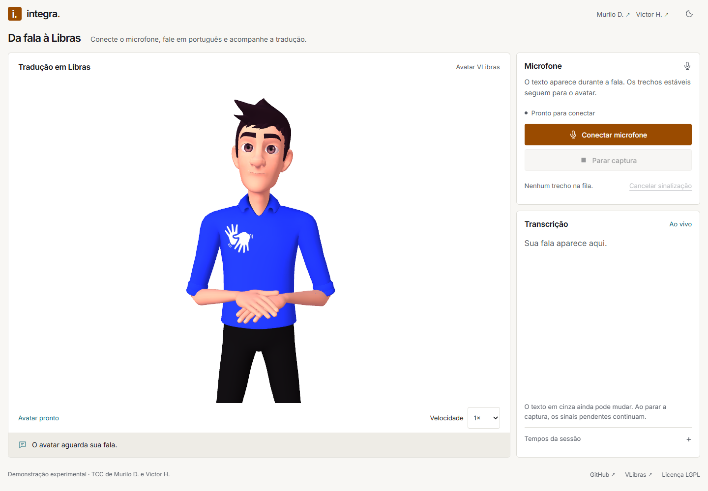
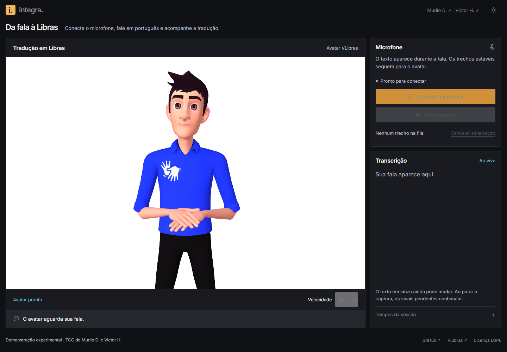

<p align="center">
  
</p>

<h1 align="center">Integra MQF</h1>

<p align="center">Da fala em português à transcrição e aos sinais em Libras.</p>

<p align="center">
  
  
  
  
</p>

<p align="center">
  <a href="#por-dentro-do-integra">Interface</a> ·
  <a href="#como-usar">Como usar</a> ·
  <a href="#executar-localmente">Executar localmente</a> ·
  <a href="https://github.com/self1027/Integra/tree/sistema-completo">Sistema completo</a>
</p>

O Integra captura a fala pelo microfone, transcreve o áudio em português e apresenta os sinais em Libras com o avatar do VLibras. A transcrição e a sinalização ficam na mesma tela, para acompanhar o texto reconhecido e a reprodução dos trechos.

Este projeto foi desenvolvido por **Murilo Dias e Victor Hugo** como parte de um **Trabalho de Conclusão de Curso (TCC)**, com foco em acessibilidade digital e comunicação. Este repositório apresenta uma demonstração técnica do núcleo de transcrição e sinalização do **Integra MQF**, que faz parte de um sistema maior.

A `main` concentra a demonstração. A versão completa, com os módulos complementares de autenticação, permissões e gestão, foi preservada na branch [`sistema-completo`](https://github.com/self1027/Integra/tree/sistema-completo).

## Por dentro do Integra

O avatar, os controles do microfone e a transcrição dividem a interface. Você pode acompanhar os trechos reconhecidos e ajustar a velocidade dos sinais.



A interface também oferece um tema escuro, acessível pelo botão no canto superior direito.



*Capturas da demonstração local, com o avatar carregado e sem uma sessão de microfone ativa.*

## O que dá para fazer

- Capturar a fala em português pelo microfone do navegador.
- Acompanhar a transcrição enquanto fala, com reconhecimento local pelo Vosk.
- Enviar trechos estáveis para tradução e reprodução pelo avatar VLibras.
- Ajustar manualmente a velocidade dos sinais entre 0,5× e 4×.
- Parar a captura e deixar o avatar concluir os trechos pendentes, ou cancelar a sinalização.
- Tentar novamente uma tradução que falhou e conferir correções de trechos já sinalizados.

## Como usar

1. Com o servidor em execução, abra **https://localhost/**.
2. Clique em **Conectar microfone** e permita o acesso no navegador.
3. Fale em português e acompanhe a transcrição e o avatar.
4. Clique em **Parar captura** para encerrar o áudio e manter os sinais pendentes.

O texto em cinza ainda pode mudar durante o reconhecimento. **Cancelar sinalização** interrompe o avatar, limpa a fila e encerra a sessão. A velocidade pode ser ajustada no controle abaixo do avatar; ela não aumenta automaticamente quando há trechos acumulados.

## Executar localmente

<details>
<summary>Requisitos e instalação</summary>

Você precisa de:

- **Node.js 22 ou superior**.
- **FFmpeg** instalado e disponível no `PATH`.
- Modelo português do Vosk na pasta `vosk-model-small-pt-0.3/`, na raiz do projeto.
- Certificado local e chave privada nos arquivos `cert.pem` e `key.pem`, também na raiz.

O modelo e os certificados não são versionados. Com esses arquivos preparados, execute na pasta do projeto:

```bash
npm install
npm start
```

Abra **https://localhost/** e aceite o certificado local, se necessário. O acesso ao microfone fora de `localhost` exige HTTPS. As portas ficam em [config.js](config.js): HTTPS `443`, HTTP `2000` e redirecionamento `1000`.

Os arquivos do player já estão em [public/player/](public/player/). A origem e os hashes estão no [manifesto do player](public/player/upstream.json).

</details>

<details>
<summary>Como funciona e onde encontrar cada parte</summary>

O fluxo é: **microfone → áudio PCM → Vosk → texto → tradução para glosas → avatar VLibras**.

O FFmpeg converte o áudio para PCM mono a 16 kHz. O servidor Node.js recebe o áudio via WebSocket, acompanha as revisões da transcrição e prepara os próximos blocos enquanto o navegador reproduz o atual. O player usa diretamente o renderizador Unity/WebGL do VLibras.

| Parte | Responsabilidade |
| --- | --- |
| [audioPipeline/VoskSTT.js](audioPipeline/VoskSTT.js) | Reconhecimento, resultados parciais e tempos das palavras |
| [audioPipeline/Ffmpeg.js](audioPipeline/Ffmpeg.js) | Conversão e conclusão do áudio pendente ao parar |
| [audioPipeline/StreamingSession.js](audioPipeline/StreamingSession.js) | Estabilidade, revisões e ordem dos blocos |
| [audioPipeline/Translator.js](audioPipeline/Translator.js) | Tradução HTTP, novas tentativas e cache |
| [wsServer/websocket.js](wsServer/websocket.js) | Comunicação de áudio e controles com o navegador |
| [public/js/player.mjs](public/js/player.mjs) | Reprodução e eventos do avatar |
| [public/js/audio_ws.js](public/js/audio_ws.js) | Microfone, transcrição e controles da interface |

A fila aceita até 12 blocos. Se o avatar ficar para trás, a captura é interrompida com aviso e os trechos aceitos são preservados. Revisões invalidam traduções e blocos que ainda não começaram; correções conflitantes com sinais já exibidos exigem uma escolha na interface.

</details>

<details>
<summary>Testes e validação técnica</summary>

```bash
npm test
git diff --check
```

Os testes usam `node:test`, um servidor HTTP local e FFmpeg. Cobrem revisões de transcrição, ordem dos blocos, cancelamento, falhas de tradução, eventos do player e conclusão do áudio pendente. Não chamam os serviços públicos nem exigem carregar o modelo Vosk.

A validação de navegador com áudio sintetizado está registrada no [relatório técnico](docs/superpowers/validation/2026-11-02-player-streaming.md).

</details>

## Contexto e limites da demonstração

A transcrição roda localmente, mas a tradução e os arquivos dos sinais usam os serviços públicos `traducao2.vlibras.gov.br` e `dicionario2.vlibras.gov.br`. Portanto, a demonstração precisa de conexão com a internet. A página também mantém a integração de métricas Microsoft Clarity.

A sinalização incremental é experimental: trechos menores podem perder contexto, e sinais já exibidos não podem ser desfeitos. A fila permite sobrepor as etapas, mas não garante que o avatar acompanhe qualquer velocidade de fala. A qualidade linguística e a compreensão precisam de avaliação com pessoas fluentes em Libras.

O motor e os sinais são do [VLibras](https://github.com/spbgovbr-vlibras). Os arquivos redistribuídos estão sob a [licença LGPL](public/player/LICENSE), com origem e links para o código no [manifesto](public/player/upstream.json).

---

Desenvolvido por [Murilo Dias](https://murilod.dev/) e [Victor Hugo](https://www.linkedin.com/in/victor-hugo-souza-41339a21b/) · Projeto de TCC em acessibilidade digital.
